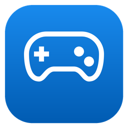
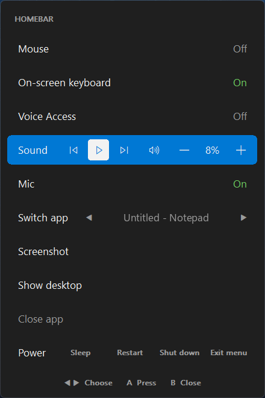

<p align="center">
  
</p>

<h1 align="center">HomeBar</h1>

<p align="center">
  <b>A controller Home-button menu for Windows, built for the couch.</b><br>
  Press <b>Home</b> on your controller for a mouse, a keyboard, sound, app switching and power, without reaching for the desk.
</p>

<p align="center">
  
  
  
  <a href="LICENSE"></a>
  
</p>

<p align="center">
  
</p>

---

## Contents

- [Why HomeBar](#why-homebar)
- [Features](#features)
- [Controls](#controls)
- [Install](#install)
- [Uninstall](#uninstall)
- [Compatibility](#compatibility)
- [Troubleshooting](#troubleshooting)
- [Building from source](#building-from-source)
- [How it works](#how-it-works)
- [Releasing](#releasing)
- [License](#license)

## Why HomeBar

Xbox Game Bar opens on the Home button, but it's built for capturing clips and chatting, not for using a PC from the sofa. HomeBar replaces it with one small menu covering what you need when the keyboard and mouse are out of reach. It's a single native executable: no runtime, no services, and no network access apart from an update check you start yourself.

## Features

| Item | What it does |
|---|---|
| **Mouse** | Turns the controller into a mouse. Left stick moves the cursor, right stick scrolls (vertically and sideways), **A** left-clicks, **B** right-clicks. Stays on until you turn it off. |
| **On-screen keyboard** | Opens or closes the Windows touch keyboard, falling back to the classic `osk.exe` if it can't open. |
| **Voice Access** | Starts or stops Windows Voice Access, the speech recognition that runs on your PC. Say *"voice access wake up"* and dictate into any text box. |
| **Sound** | Previous, play/pause, next, mute and volume − / + with the current level. Hold **A** on − / + to keep changing the volume. |
| **Mic** | Mutes or unmutes the default microphone for every app, including Discord and calls. |
| **Switch app** | **◀ ▶** cycles through open apps; **A** brings the shown one to the front. |
| **Screenshot** | Saves the screen the menu is on as a PNG in `Pictures\Screenshots`, without the menu, and shows a notification that opens it. |
| **Show desktop** | Minimises everything; pick it again to bring the windows back. |
| **Close app** | Closes the app in front, as if you clicked its X. If it asks something like *"Save changes?"*, that dialog comes to the front. If the app ignores the request, the row turns red and **A** again force-closes it. Unavailable on the desktop. |
| **Power** | Sleep, Restart, Shut down or Exit menu, each confirmed with **Are you sure?** |

**Tray icons**

- A **gamepad** icon shows while HomeBar runs. Right-click it for **Start with Windows**, **Check for updates** and **Exit**.
- A **red muted-mic** icon appears while the microphone is muted, however it was muted. Click it to unmute.

The mic icon, mic row and volume level update the moment anything changes them, including Windows Settings and switching audio devices.

## Controls

| Button | In the menu |
|---|---|
| **Home** | Open / close the menu |
| **D-pad / left stick** | Move between rows; **◀ ▶** choose within a row |
| **A** | Select / confirm |
| **B** | Close the menu / cancel a confirmation |
| **LT / RT** | Volume down / up, from any row |
| **LB / RB** | Previous / next track, from any row |

Clicking outside the menu or switching windows with Alt+Tab also closes it.

## Install

1. Download **`HomeBar-Setup.exe`** from the [latest release](../../releases/latest).
2. Run it, choose whether HomeBar should **start with Windows**, click **Install** and accept the Windows permission prompt.

> **SmartScreen warning?** The setup isn't signed by a publisher. Click **More info → Run anyway**.

The setup:

- installs HomeBar to `C:\Program Files\HomeBar` and starts it;
- signs `HomeBar.exe` with a certificate made for this PC only. Its key exists only in memory while signing, so nothing else can ever be signed with it. Windows needs this signature to let the menu appear above other always-on-top windows (`uiAccess`);
- adds shortcuts to the desktop and Start menu, and lists HomeBar under **Settings → Apps → Installed apps**.

**Start with Windows** can be changed any time from the tray icon's right-click menu. Running the setup again updates HomeBar in place. If any step fails, the setup undoes what it changed.

## Uninstall

Uninstall **HomeBar** from **Settings → Apps → Installed apps**. This removes the program, shortcuts, settings, tray entries, the signing certificate and the log. If HomeBar turned off Game Bar's Home-button shortcut, uninstalling turns it back on.

## Compatibility

- **Windows 11.** Voice Access needs 22H2 or later.
- **Controllers:** anything that works as an Xbox (XInput) controller. PlayStation controllers need DS4Windows or Steam Input.
- **Xbox Game Bar:** when HomeBar starts and finds Game Bar's Home-button shortcut on, it **asks** before turning it off. Only the controller shortcut changes; Game Bar and Win+G keep working. Choosing No is remembered.
- **Steam:** Steam also listens to the Home button. If both open, turn off the Guide-button shortcut in Steam's controller settings.
- **Games:** the menu appears over borderless and windowed games, not exclusive fullscreen. Games still receive the buttons you press in the menu; Windows has no way to hide controller input from them.

## Troubleshooting

| Problem | Fix |
|---|---|
| Nothing happens on Home | Check that the gamepad icon is in the tray. If Game Bar or Steam opens instead, see [Compatibility](#compatibility). |
| `HomeBar.exe` won't start when run directly | Expected for a build outside Program Files: `uiAccess` apps must be signed and installed. Use `HomeBar-Setup.exe`. |
| Tray icon is in the overflow | HomeBar promotes it automatically. Right after a reinstall, Explorer may need a restart (or pin it under **Settings → Personalization → Taskbar**). |
| Something failed silently | Failures are logged to `%TEMP%\HomeBar.log`. |

## Building from source

Requires the [Rust toolchain](https://rustup.rs) with the MSVC target.

```powershell
cargo build --release
```

This produces `target\release\HomeBar-Setup.exe` with the app built into it. Run it to install your build.

Command-line switches of the installed `HomeBar.exe`, for scripts and testing:

| Switch | Effect |
|---|---|
| `--quit` | Closes the running copy cleanly, removing its tray icons. |
| `--keyboard` | Toggles the on-screen keyboard. |
| `--keyboard-visible` | Exits with `1` if the keyboard is showing, `0` if not. |
| `--screenshot` | Takes a screenshot. |
| `--show-desktop` | Toggles Show desktop. |
| `--check-updates owner/repo` | Runs the update check against any GitHub repository. |

## How it works

- **Input:** a background thread reads the controller with XInput, including the Guide button, 125 times a second and posts button events to the UI thread.
- **Layering:** the executable is built with `uiAccess`, which places the menu above every always-on-top window.
- **Audio:** volume and mute use the Core Audio endpoint APIs with change notifications; nothing is polled.
- **Screenshots:** captured with GDI once the menu is hidden and the compositor has redrawn, then encoded to PNG with WIC.
- **Setup:** a separate native executable that carries `HomeBar.exe`. It does the Program Files work in one elevated step, signing with CryptoAPI and an in-memory CNG key, and does the per-user parts (desktop shortcut, Start with Windows) as the signed-in user.
- **Dependencies:** Microsoft's own bindings only: [`windows`](https://crates.io/crates/windows) for COM and WinRT (typed interfaces, checked by the compiler) and [`windows-sys`](https://crates.io/crates/windows-sys) for the plain Win32 API; `embed-resource` at build time for icons and manifests.

```
src/               the app
├── main.rs        entry point, windows, command-line switches
├── pad.rs         controller reading, key repeat, mouse mode
├── menu/          menu state and drawing
├── audio.rs       volume and microphone
├── apps.rs        switching, closing, power, show desktop
├── capture.rs     screenshots
├── keyboard.rs    on-screen keyboard
├── tray.rs        tray icons and menu
├── update.rs      GitHub release check
├── startup.rs     Start with Windows
└── settings.rs    Game Bar, tray promotion, theme
setup/src/         HomeBar-Setup.exe
├── main.rs        install and uninstall flow
├── machine.rs     administrator step: Program Files, Start menu, Settings > Apps
├── signing.rs     local code-signing certificate
├── user.rs        desktop shortcut, Start with Windows, per-user cleanup
├── shortcut.rs    .lnk shortcuts
├── dialog.rs      setup dialogs
└── win.rs         Win32 helpers
```

## Releasing

The update check compares the workspace `version` in `Cargo.toml` with the latest GitHub release of this repository. Tag releases to match, for example `v1.1.0`, and attach `HomeBar-Setup.exe`.

## License

[MIT](LICENSE)
